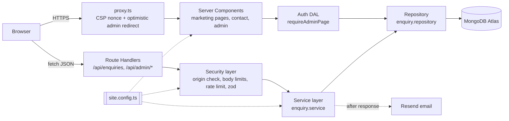
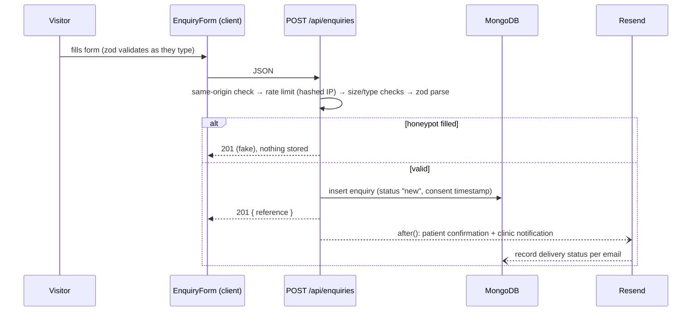

# Architecture

## Goals → design decisions

| Business goal                   | How the system serves it                                                                                                                                                                                                                                    |
| ------------------------------- | ----------------------------------------------------------------------------------------------------------------------------------------------------------------------------------------------------------------------------------------------------------- |
| Look professional and on-brand  | One config-driven design system (colours, fonts and copy all come from `site.config.ts`). The palette is calm teal and warm sand, with terracotta reserved for booking actions.                                                                             |
| Explain the services quickly    | Service cards show who each service is for, session length and a starting price in ₹. Every card links to its own anchored section and to a booking form with that service already filled in.                                                               |
| Get more enquiries              | Every page has a booking CTA (sticky in the header) plus a WhatsApp shortcut. The form is short and validates as you type, with clear errors and a confirmation reference. A confirmation email and a callback within one working day reassure the patient. |
| Fast, findable, mobile-friendly | Server-rendered HTML with minimal client JavaScript, self-hosted fonts, AVIF/WebP images, per-page metadata, a sitemap, robots.txt and `Physiotherapy` structured data.                                                                                     |

## Stack and why

| Layer      | Choice                                   | Reason                                                                                                                                                                                                                                                    |
| ---------- | ---------------------------------------- | --------------------------------------------------------------------------------------------------------------------------------------------------------------------------------------------------------------------------------------------------------- |
| Framework  | **Next.js 16 (App Router) + TypeScript** | One codebase for the pages and the backend API, so there is one deploy. Server Components ship almost no JavaScript, and SEO tooling (Metadata API, sitemap, OG images) is built in. Strict TypeScript catches content and config mistakes at build time. |
| Styling    | **Tailwind CSS v4**                      | Design tokens map straight to the config-driven CSS variables. Output is a single static, same-origin stylesheet, which is compatible with a strict CSP (unlike runtime CSS-in-JS).                                                                       |
| Database   | **MongoDB Atlas** (official driver)      | The managed free tier fits a small clinic. An enquiry is naturally a document. TTL indexes power both rate limiting and data retention without cron jobs.                                                                                                 |
| Email      | **Resend** + React Email                 | A simple API with idempotency keys. Templates are typed React components that share the site's config.                                                                                                                                                    |
| Validation | **zod**                                  | One schema validates the form in the browser and the request on the server.                                                                                                                                                                               |
| Auth       | **jose** + Node `crypto` (scrypt)        | No auth SaaS is needed for a single admin. Both run on any runtime with no native dependencies.                                                                                                                                                           |
| Hosting    | **Vercel**                               | Zero-config Next.js hosting: preview deployments per push, HTTPS and HSTS.                                                                                                                                                                                |

No client-side state library is used: data is fetched in Server Components and mutations go through the API
followed by `router.refresh()`, so the database stays the single source of truth.

## High-level view

### Layers

- **`src/config/`**: the single source of truth for business data, copy, theme, SEO and security limits. Secrets are deliberately _not_ in it (they are environment variables).
- **`src/app/`**: routes only. Pages compose components; route handlers orchestrate the security and service layers.
- **`src/components/`**: UI. Components are Server Components by default; `"use client"` is used only on small interactive leaves (mobile nav, form, status select).
- **`src/lib/`**: framework-independent logic:
  - `enquiries/`: schema, service and repository. Only the repository talks to the `enquiries` collection.
  - `auth/`: password hashing, session tokens, cookie handling and the DAL.
  - `security/`: CSP, request guards and the rate limiter.
  - `http/`: the typed error and response envelope.
  - `email/`: the Resend client and templates.
  - `format.ts`: Indian locale formatting (₹, +91, DD/MM/YYYY, IST).

## Key flows

### Enquiry submission

Emails are sent **after** the response with `after()`, so a slow or failing email provider never blocks or fails
the patient's submission. Each outcome (`sent`, `simulated`, `failed`, `skipped`) is stored on the enquiry and
shown in the admin. Without `RESEND_API_KEY` the system runs in **simulated email** mode and logs the email instead.

### Admin

1. `proxy.ts` redirects unauthenticated `/admin` requests to `/admin/login`. This is for UX only.
2. `POST /api/admin/session`: rate-limited, scrypt-verified. It sets an 8-hour `__Host-` session cookie.
3. The dashboard page calls `requireAdminPage()` before loading data, and the admin API routes verify the session themselves.
4. Status changes call `PATCH /api/admin/enquiries/:id`, which updates optimistically in the UI, persists, then refreshes server data.
5. Search, filters and sorting live in the URL (`?q=&status=&service=&period=&sort=&page=`), so every view can be
   reloaded, bookmarked and shared, and works without JavaScript. The page and `GET /api/admin/enquiries` validate
   them with the same schemas (the page falls back per field; the API answers 400). Search text is regex-escaped
   and matched literally against name, email, reference and message, and against phone numbers by digits. These
   unanchored regexes can't use an index, which is acceptable at a clinic's volume with 12-month retention; a
   larger deployment would move to Atlas Search.

## Data model

**`enquiries`**

| Field                                                  | Notes                                                                                                              |
| ------------------------------------------------------ | ------------------------------------------------------------------------------------------------------------------ |
| `reference`                                            | `MS-YYMMDD-XXXXX`: easy to read out over the phone (no 0/O/1/I). Unique index.                                     |
| `name`, `email`, `phone`                               | Phone stored in E.164 (`+91…`), email lower-cased.                                                                 |
| `service`, `preferredDate`, `preferredTime`, `message` | Date stored as a calendar date string (`YYYY-MM-DD`), so it is time-zone safe.                                     |
| `status`                                               | `new → contacted → booked → closed`                                                                                |
| `consentAt`                                            | DPDP consent evidence.                                                                                             |
| `source.ipHash`                                        | Keyed HMAC of the IP, never the raw IP.                                                                            |
| `notifications.patient / .clinic`                      | Email delivery outcome.                                                                                            |
| `retainUntil`                                          | Retention deadline (created + 12 months). Removed when the status becomes `booked` and restored if that is undone. |
| `createdAt`, `updatedAt`                               |                                                                                                                    |

Indexes: `{createdAt: -1}` (dashboard list), `{status: 1, createdAt: -1}` (filtered list), a unique `{reference: 1}`, and a **TTL index on `retainUntil`**. MongoDB deletes expired enquiries itself, so the privacy notice's retention promise is enforced by the database with no cron job.

**`rate_limits`**: `{ _id: "<scope>:<ipHash>", count, expiresAt }`, with a TTL index on `expiresAt`. Each request is
counted with one atomic `findOneAndUpdate`, using an aggregation pipeline that resets expired windows.

## Rendering and CSP (the main trade-off)

A **strict nonce-based CSP** needs each HTML response to carry a fresh nonce, so pages are rendered per request.
Next.js's static pre-rendering and Cache Components/PPR are therefore disabled. I chose security over CDN-cached
HTML because the site collects personal data and has an admin area. Performance stays high anyway: pages are
lightweight Server Components, there is very little client JS, and fonts and images are optimised. Static assets
are still served from the CDN.

**With more time:** evaluate Next.js's (experimental) SRI / hash-based CSP to bring back static generation for the
marketing pages while keeping a strict policy.

## Error handling and API contract

- Success: `{ "data": … }`. Error: `{ "error": { "code", "message", "fields?" } }` with an appropriate status (400, 401, 403, 404, 413, 415, 429 + `Retry-After`, 500).
- Known errors are thrown as a typed `HttpError`. Anything unexpected is logged as structured JSON (without personal data) and returned as a generic 500.

## Testing and CI

- Vitest unit tests cover validation (Indian phone and date rules), formatting, CSP, password hashing, session tokens and the request guards.
- GitHub Actions runs lint, type-check, tests, the production build and `npm audit` on every push and PR.
